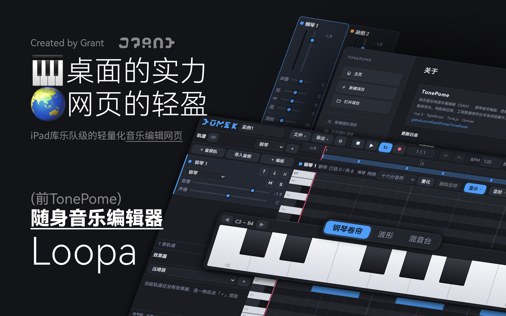

<div align="center">
  
</div>

<h1 align="center">Loopa · 随身库乐队</h1>

<p align="center">
  <em>灵感即弹，打开即作 —— 浏览器里的音乐宇宙</em><br />
  GarageBand 级的轻量化音乐编辑软件，纯前端实现，打开即用
</p>

<p align="center">
  
  
  
  
  
</p>

<p align="center">
  <a href="https://grantpome.github.io/TonePome/"><b>▶ 在线体验</b></a>
</p>

---

## 这是什么

Loopa 是一款运行在浏览器里的「随身库乐队」。它不依赖任何后端服务，全部编曲、录音、混音与导出都在本地完成，把一条完整的创作链路塞进一个网页里：

**编曲 → 录音 → 混音 → 导出**

界面参考库乐队的克制配色与信息密度，同时针对 PC 与平板触控两套操作习惯做了适配，力求「打开就能弹」。

## 功能特性

### 🎹 编曲与音符编辑
- **钢琴卷帘编辑器**：Canvas 绘制，仅渲染视口内音符，海量音符也不卡顿
- **完整音符编辑**：绘制 / 拖拽 / 拉伸 / 框选，支持复制、剪切、粘贴与快速再制
- **力度工具**：统一设置、整体缩放、人性化随机，配合底部力度条与按力度着色
- **量化对齐**：一键把选中音符吸附到当前网格
- **微调**：`↑ / ↓` 调力度，`Shift + ↑ / ↓` 移调
- **底部缩略导航条**：点击或拖拽即可快速定位当前视口
- **多拍号支持**：2/4、3/4、4/4、5/4、6/8、7/8、9/8、12/8 共 8 种
- **节拍器 / 预备拍 / 循环播放**
- **虚拟键盘**：触屏随手试音

### 🎛 混音与效果器
- **双总线混音架构**：各轨汇入干声总线 + 共享混响总线，实时播放与离线导出听感一致
- **每轨独立通道**：效果器链 → 三段均衡（EQ3）→ 声像 → 推子 → 电平表
- **6 种效果器**：压缩、延迟、合唱、失真、滤波、移相
- **总线限幅器**：防止总输出削波
- **音量读数可切换**：dB / 线性百分比两种显示

### 🎤 录音与音频轨
- **麦克风录音**：从播放头位置直接录制成音频轨
- **波形视图与编辑**：波形绘制，片段可拆分、复制、拖动与裁剪时长
- **片段增益与淡入淡出**：单个片段独立调节音量与首尾淡入淡出
- **音频导入**：把本地音频文件导入为波形片段

### 🎺 乐器与音源
- **13 种内置音色**：钢琴、电钢琴、风琴、吉他、贝斯、弦乐、铜管、长笛、铃铛、氛围铺底、合成主音、鼓组、电子鼓组
- **乐器与音源管理器**：统一窗口浏览全部音色、逐个试听、一键应用到当前轨道
- **自定义音源**：导入自己的采样（wav / mp3 / ogg）拼装成独立音色
  - 旋律音源：按采样原始音高自动移调，可弹任意音高
  - 鼓组音源：每个采样绑定 GM 音号，命中即原速播放
- 采样 PCM 存入 **IndexedDB**，工程文件只保存元信息，体积轻盈

### 💾 工程与导入导出
- **工程文件**：导出 / 导入 JSON，完整保留编曲数据
- **MIDI 导入导出**：标准 SMF 格式（.mid）
- **WAV 导出**：`Tone.Offline` 离线渲染 + 原生 16bit PCM 编码
- **历史工程**：自动保存到浏览器本地（最多保留 12 个），随时切换
- **撤销 / 重做**：快照式历史引擎，覆盖编曲、混音等各类操作

### 🧩 界面与交互
- **可编排的三区域布局**：左栏 / 中央主区 / 底部栏，板块可跨区域拖拽排序
- **布局编辑模式**：拖拽分隔条调整板块宽高，权重比例模型自适应窗口缩放，配置持久化到 localStorage
- **PC / Pad 双设备模式**：触控优先的控件放大、长按替代右键
- **移动端手势**：长按框选、长按拖拽音符、多指事件隔离，防误触
- **过渡动画**：弹窗淡入上浮、分段 Tab 指示块两段式滑动、列表项增删过渡
- **深色主题**：低饱和、层次分明的专业配色

## 技术栈

| 分类 | 技术 |
| --- | --- |
| 框架 | Vue 3（`<script setup>` + Composition API） |
| 语言 | TypeScript |
| 音频 | Tone.js（统一 `Tone.Transport` 调度，无 setTimeout 计时） |
| 绘图 | 原生 Canvas 2D（钢琴卷帘 / 波形 / 电平表） |
| 构建 | Vite |
| 存储 | localStorage（工程与布局） + IndexedDB（音频采样 PCM） |
| 部署 | GitHub Actions → GitHub Pages |

## 快速开始

```bash
# 安装依赖
npm install

# 启动开发服务器（默认 http://localhost:5173/）
npm run dev

# 类型检查
npm run typecheck

# 生产构建（含类型检查）
npm run build

# 本地预览构建产物
npm run preview
```

> 提示：受浏览器 WebAudio 策略限制，音频上下文需要用户**首次点击页面**后才会激活，页面加载时不会自动发声。

## 快捷键

| 操作 | 快捷键 |
| --- | --- |
| 播放 / 暂停 | `Space` |
| 撤销 / 重做 | `Ctrl + Z` / `Ctrl + Shift + Z`（或 `Ctrl + Y`） |
| 删除选中音符 / 片段 | `Delete` / `Backspace` |
| 调整力度 | `↑` / `↓` |
| 移调（半音） | `Shift + ↑` / `Shift + ↓` |
| 取消选择 / 退出编辑模式 | `Esc` |

**钢琴卷帘手势**

| 操作 | 手势 |
| --- | --- |
| 移动音高 | 滚轮 |
| 左右滚动 | `Shift + 滚轮` |
| 缩放 | `Ctrl + 滚轮` |
| 框选 | `Shift + 拖拽` |

## 项目结构

```
src/
├─ components/          # 界面组件
│  ├─ TopToolbar.vue        # 顶栏：文件/导出、播放、视图切换
│  ├─ TrackList.vue         # 左侧轨道面板
│  ├─ TrackRow.vue          # 单条轨道行
│  ├─ PianoRoll.vue         # 钢琴卷帘编辑器
│  ├─ AudioEditor.vue       # 波形编辑器
│  ├─ MixerPanel.vue        # 混音台
│  ├─ InstrumentDialog.vue  # 乐器与音源管理器
│  ├─ BuiltinInstrumentsPanel.vue
│  ├─ CustomSoundsPanel.vue
│  └─ ...
├─ core/                # 核心逻辑（与界面解耦）
│  ├─ audioEngine.ts        # 音频引擎（单例，Tone.js 信号链）
│  ├─ instruments.ts        # 乐器合成与自定义音源
│  ├─ effects.ts            # 效果器统一接口
│  ├─ recorder.ts           # 录音
│  ├─ audioStore.ts         # 采样 PCM 的 IndexedDB 存储
│  ├─ midi.ts               # MIDI 导入导出
│  ├─ history.ts            # 撤销重做
│  ├─ layout.ts             # 可编排布局
│  ├─ persistence.ts        # 工程持久化
│  ├─ segThumb.ts           # 分段 Tab 滑动指示块
│  └─ store.ts              # 全局状态与业务 API
├─ types/               # Project / Track / Region / Note 等类型定义
├─ utils/               # 音乐、音频、波形、WAV 编码等工具
└─ styles/              # 全局样式与主题令牌
```

## 部署

项目已配置 GitHub Actions，推送到 `main` 分支后会自动完成「类型检查 → 构建 → 发布到 GitHub Pages」。

线上地址：<https://grantpome.github.io/TonePome/>

构建时 `vite.config.ts` 会自动带上 `/TonePome/` 子路径前缀以适配项目页部署，本地开发与预览仍使用根路径。

## 浏览器要求

推荐使用最新版 **Chrome / Edge / Safari**。需要浏览器支持 WebAudio API、IndexedDB 与 Pointer Events。

---

<p align="center">
  <b>Loopa</b> · 随身库乐队<br />
  Created by <a href="https://github.com/GrantPome">Grant</a>
</p>
